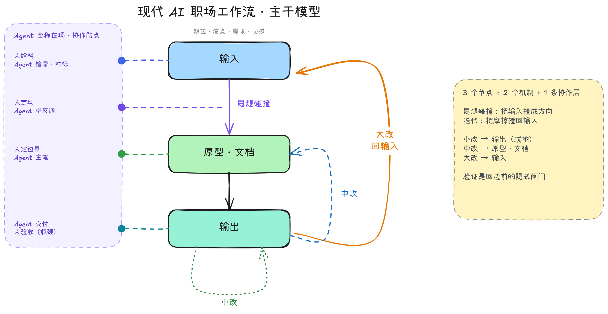

# 现代 AI 职场工作流：从线性流水线到低成本的人机协作回环

**当生成与实现的成本快速下降，一部分知识工作的重心，正更多地从“亲手完成每一步”移向“定义问题、组织上下文、验证输出并承担责任”。**

## 写在前面

本文提出一个用于观察现代知识工作的概念模型。它源于实践与推演，不是经过统计检验的普遍规律，也不是要求所有团队照抄的标准作业程序。它试图回答三个问题：

1. AI Agent 进入工作后，流程的基本形状发生了什么变化？
2. 人与 Agent 在不同阶段如何分工？
3. 这套工作方式在什么条件下有效，又会在哪里失效？

图与文章都应被视为可修订的认知底稿：新的实践如果推翻了旧判断，模型就应随之改变。完整的主干模型图见下一节。

---

## 摘要

许多传统知识工作以线性流程组织：需求澄清、评审、分工、制作、交付、结项。AI Agent 并没有让这种流程彻底消失，但它显著降低了检索、起草、原型制作和局部实现的成本，使部分工作可以更早进入“做出来再判断”的状态。

本文将这种变化概括为一个由**三个节点、两个机制和一条人机协作层**构成的回环模型：

- 三个节点：输入、原型·文档、输出；
- 两个机制：思想碰撞与迭代；
- 一条协作层：Agent 全程参与，但人与 Agent 的主导权随阶段漂移。

本文的核心命题是：

> **现代 AI 工作流不是简单地把某一步交给 AI，而是让人与 Agent 围绕输入、原型和输出形成更短的反馈回路。Agent 扩展生成与实现，人负责目标、边界、验证和最终责任。**

因此，流程的主要变化不是“直线被完全替代”，而是线性主干之外出现了更频繁、更低成本的回返与短路。

---

## 一、核心变化：回环不是新事物，但它的成本被大幅压低

| 维度         | 典型线性流程                     | AI 增强的回环流程                                |
| ------------ | -------------------------------- | ------------------------------------------------ |
| 形状         | 以阶段推进为主，回返成本较高     | 保留主干，但允许频繁回返和局部短路               |
| 起点         | 倾向先把需求定义清楚             | 可以从粗糙生料开始：想法、痛点、需求或灵感       |
| 成本结构     | 先充分规划，以降低制作和返工成本 | 先生成低成本样品，再据实物判断是否继续           |
| 关键能力     | 专业执行、协作与流程控制         | 在此基础上增加问题定义、上下文组织和输出验证     |
| 人的角色     | 直接执行并协调多个环节           | 既执行，也负责定向、取舍、验收和责任承担         |
| Agent 的角色 | 不适用或仅作为局部工具           | 参与检索、推演、起草、制作、修改与验证辅助       |
| 周期         | 常按天、周或项目阶段推进         | 局部循环可压缩到分钟或小时，整体周期仍视任务而定 |

这里并不是要制造“旧职场与新职场”的二元对立。线性流程仍然适用于稳定、合规和跨部门协同的任务；变化在于，AI 让其中一部分探索与制作活动获得了快速回环的可能。

也要说清楚：迭代与回环本身并不是 AI 的发明——敏捷、精益、PDCA 早已是回环。真正变化的不是“出现了回环”，而是**回环的成本结构**：AI 让检索、起草、原型和局部实现变得足够便宜，同一个回环因此可以更短、更频繁、更早撞上现实。所以本文说的“从线性到回环”，指的是成本下降后回环变得划算，而不是一种此前不存在的全新形状。

一句话概括：**在这类工作里，当部分实现成本下降，价值往往会向问题定义、判断质量与责任承担一侧倾斜。**

---

## 二、主干模型

模型由**三个节点、两个机制和一条协作层**组成。本节先解释流程主干，下一节再展开人机分工。



> 图：主干三节点（输入 → 原型·文档 → 输出）、左侧贯穿全程的人机协作层，以及三种分级迭代回边（小改就地、中改回原型、大改回输入）。可编辑源文件：[workflow.excalidraw](./workflow.excalidraw)

“节点”表示阶段性产物，“机制”表示推动产物变化的动作。因此，思想碰撞和迭代不被画成独立交付阶段，而是位于节点之间或反馈路径上。

```
   输入（想法·痛点·需求·灵感） ◀───────────────┐
        │                                     │
     思想碰撞                              大改 │
        ▼                                     │
   原型 · 文档 ◀──────────────┐               │
        │                     │ 中改          │
        ▼                     │               │
       输出 ──────────────────┴───────────────┘
        ▲  │                        （迭代回边）
        └──┘ 小改（就地修正）
```

三条迭代回边对应三种落点：**小改**在输出层就地修正（自环），**中改**回到原型·文档，**大改**回到输入。越小的改动，回环越短。

### 三个节点

| 节点            | 定义                                                         | 进入下一阶段的判断               |
| --------------- | ------------------------------------------------------------ | -------------------------------- |
| **输入**        | 尚未充分收敛的生料：想法、痛点、需求或灵感                   | 能否说清这一轮要验证什么         |
| **原型 · 文档** | 面向内部判断、允许舍弃的可演示物及其边界说明                 | 是否值得投入，并形成真实使用意图 |
| **输出**        | 准备被使用、评审或决策的结果：工具、文稿、脚本、页面、方案等 | 是否通过验证；反馈应落回哪一层   |

原型与输出的区别不在文件格式，而在**使用意图**：仍用于证明“值不值得做”的，是原型；已经准备被真实使用、评审或决策的，是输出。对于简单任务，两者可能是同一个对象，只是状态发生了变化。

### 两个机制

两个机制方向相反：思想碰撞把生料向前收敛，迭代把真实反馈送回合适的节点。

| 机制         | 在哪条边           | 做什么                                                     |
| ------------ | ------------------ | ---------------------------------------------------------- |
| **思想碰撞** | 输入 → 原型 · 文档 | 通过追问、对照、反例和方案比较，把模糊生料收敛为可验证方向 |
| **迭代**     | 输出 → 合适节点    | 根据验证结果与使用反馈，选择最短而足够的回返路径           |

迭代的落点分级：

| 摩擦 | 落回                 | 例子                       |
| ---- | -------------------- | -------------------------- |
| 小改 | **输出**（就地修正） | 文案、格式、局部缺陷       |
| 中改 | **原型 · 文档**      | 交互或方案路径需要调整     |
| 大改 | **输入**             | 问题定义或方向本身需要重做 |

回返的原则不是“总要重开一轮”，而是选择能解决问题的最短路径。每次迭代只需明确三件事：保留什么、改变什么、删除什么。

这套主干的意义，不在于节点数量，而在于它允许反馈有分级落点：小问题不必上升为战略讨论，方向错误也不能靠不断修补输出来掩盖。

---

## 三、协作拓扑：Agent 全程在场

流程主干还没有回答一个关键问题：**AI 到底位于哪里？**

如果只把 Agent 放在某个环节，例如“让 AI 写初稿”，得到的主要是局部自动化。更值得关注的变化，是 Agent 可以贯穿输入、碰撞、原型、输出和迭代，只是在不同阶段承担不同角色。

> **Agent 不是额外增加的流程节点，而是一条贯穿流程的协作层。真正变化的是：每一阶段由谁提出、谁生成、谁判断、谁承担责任。**

这就是图左侧协作层的含义：它与主链平行，而不是插在主链中的某一格。

### 分工随阶段漂移

| 阶段            | 人                             | Agent                            | 协作重心                         |
| --------------- | ------------------------------ | -------------------------------- | -------------------------------- |
| **输入**        | 提供一手信息，判断什么值得探索 | 检索、对标、整理和补充候选材料   | 人提供现实约束，Agent 扩展信息面 |
| **思想碰撞**    | 设定边界、比较取舍、确认目标   | 提供反例、替代路径和最小方案     | 人机共同探索，人保留取舍权       |
| **原型 · 文档** | 明确边界，判断是否继续投入     | 生成原型、起草说明、执行局部实现 | Agent 承担更多生成，人持续校准   |
| **输出**        | 验收、批准使用并承担后果       | 修改、补全、检查一致性           | 生成可委托，责任不可外包         |
| **迭代**        | 判断反馈等级和回返位置         | 汇总反馈、提出修改方案并执行     | 人决定落点，Agent 加速修改       |

### 两个关键约束，决定成败

1. **生成与验证之间的不对称**  
   Agent 可以快速交出结构完整、表达流畅的结果，但“看起来完整”不等于“事实正确、逻辑成立或适合使用”。生成越快，验证越不能被省略；否则，效率提升只会变成错误传播速度的提升。

2. **协作质量对问题定义与上下文的依赖**  
   同一模型面对不同的目标、边界、材料和工具权限，会产生显著不同的结果。因此，现代职场的能力差距不仅体现在“会不会用 AI”，还体现在能否定义问题、组织上下文、设计验证，并在必要时否定 Agent 的答案。

这两个约束会在第五节被展开为可操作的基础条件（验证、上下文）。

### 由此推出的一句话

> 协作层的关键不在“谁被替代”，而在每一阶段**由谁提出、谁生成、谁判断、谁负责**：生成越来越多地下移给 Agent，判断与责任目前仍主要留在人这一侧。

需要强调，这条“人守判断与责任”的分界，是**当前 Agent 能力与问责机制下的分工**，不是一条时间无关的铁律；随着模型能力和治理方式变化，它会向前或向后移动。就眼下而言，它意味着：执行能力没有失去价值，但单纯生成内容不再足以构成可靠的专业能力。

---

## 四、逐环拆解

### 1. 输入 —— 生料，允许粗糙

一轮工作可以从尚未充分定义的材料开始。常见输入有四种，它们并不互斥：

- **想法**：我想做成什么？成功长什么样？
- **痛点**：谁在痛？现在怎么忍的？不解决会怎样？
- **需求**：谁要？验收标准是什么？约束是什么？
- **灵感**：某个案例、技术或表达方式，可能迁移到当前场景。

允许输入粗糙，不等于允许目标永远模糊。它只是把“先完全想清楚再制作”改为“先保留生料，再通过碰撞和原型逐步收敛”。

### 2. 思想碰撞（机制） —— 把生料撞成方向

思想碰撞不是独立交付物，而是输入通往原型的过程中发生的收敛动作：人与人讨论、人与 Agent 对话、旧做法与新可能互相校验。

- Agent 在这里不应只负责顺从，而应提供反例和替代路径：还有别的切法吗？如果反过来会怎样？最小可验证版本是什么？
- 碰撞结束的信号不是“大家聊够了”，而是能够明确这一轮要验证的判断及其边界。

### 3. 原型 · 文档 —— 一体产出，先能看再说

这是 AI 回环最容易产生杠杆的阶段。过去，文档、评审和制作往往依次发生；现在，部分任务可以更早产出可看、可点或可运行的样品，并让说明文档与样品同步演化。

- 目的只有一个：**以尽可能低的成本判断这条路是否值得继续。**
- 判别：仍对内、允许扔掉 → 停在本环；已有使用意图 → 进入输出。
- 风险：只有原型而没有边界说明，会让演示被误认成承诺；只有文档而没有可验证对象，则可能把错误假设包装得更完整。

### 4. 输出 —— 这一圈拿去被摩擦的结果

把值得继续的原型整理成**有真实使用意图**的结果。形态可以是工具、脚本、方案、页面、分析或决策建议。

- 输出不必一次完美，但必须达到与风险相匹配的可用和可验证标准。
- 输出一旦进入真实使用，就会暴露原型阶段无法发现的约束，这些反馈构成下一轮迭代的依据。
- 最终批准者必须知道自己在验收什么，并对采用结果承担责任。

### 5. 迭代（机制） —— 回边，不是终点后的补丁

迭代不是结项后的补丁，而是对真实反馈的分流机制。它按需短路，不要求每次都退回输入重新讨论。

摩擦分级落点见第二节表。环转得快且准，靠的是**短路用对**，不是把所有反馈都升级成「重开一轮碰撞」。

两个机制在这里合上：思想碰撞把生料推向可验证方向，迭代把反馈送回恰当的节点。

真正的效率不只来自“更快生成”，还来自减少错误层级的回返：格式问题就地修正，方案问题回到原型，方向问题才回到输入。

---

## 五、图外的四个基础条件

为了保持可读性，主图省略了四个贯穿全程的基础条件。其中前两条正是第三节两个关键约束的可操作化展开。

1. **验证：回边前的闸门**（对应第三节“生成与验证的不对称”）  
   输出进入使用前，需要按风险选择验证方式：人工复核、事实核查、测试、数据对照、同行评审或用户试用。没有验证的闭环，只是在加快错误传播。

2. **上下文：决定输出上限的材料**（对应第三节“对问题定义与上下文的依赖”）  
   文件、数据、仓库、网页、历史决策和工具权限共同构成 Agent 的工作上下文。组织上下文的能力，会直接影响结果的相关性、一致性和可追溯性。

3. **治理：权限、隐私与可追溯性**  
   不是所有材料都可以交给外部模型，也不是所有动作都应允许 Agent 自动执行。数据边界、最小权限、来源标注、版本记录和责任归属，是工作流能够进入组织环境的前提。

4. **编排：并行之后必须汇合**  
   真实工作常同时运行多个 Agent、多个草稿或多条方案。并行可以扩大搜索空间，但最终必须有人负责比较、合并和裁决。否则，多 Agent 只会制造更多相互矛盾的输出。

因此，三节点模型是一张认知地图，而不是打卡顺序；它解释主干，但不替代专业方法、组织制度和风险控制。

---

## 六、适用边界：什么时候需要减速或改造

这套模型最适合**生成成本较低、反馈较快、试错可逆，并且有人具备验收能力**的知识工作。遇到以下情形时，回环仍可使用，但必须减速并增加控制：

- **高风险或强合规工作**：财务、法务、医疗、生产安全等场景需要审批、审计、来源追踪和明确的人类责任人，不能把“快速迭代”理解为“先用再说”。
- **反馈周期很长的工作**：基础研究、复杂架构和长期战略无法依靠分钟级循环完成，需要把短回环嵌入更长的研究与决策周期。
- **缺少验收能力的工作**：如果团队无法判断输出是否正确，就应引入领域专家、外部标准或可执行测试，而不是让 Agent 自我确认。
- **上下文不可用或不可共享的工作**：当关键材料缺失、敏感或无法结构化时，Agent 的参与范围必须缩小。

一个实用判断是：**风险越高、反馈越慢、可逆性越低，回环就应该越慢，人工闸门就应该越强。**

---

## 七、结论

AI 对职场流程最深的影响，不是替某个岗位增加一个聊天窗口，而是降低了搜索、推演、起草、原型和修改的边际成本。于是，部分工作不必等到所有问题都在纸面上被解决后才开始制作，而可以通过低成本样品更早接触现实反馈。

但生成加速不等于工作自动完成。越是容易得到完整、流畅的结果，越需要清晰的目标、充分的上下文、严格的验证和明确的责任。本文把“人守判断与责任”当作当前能力与治理约束下的分工来描述，而不是对未来下的断言——这条边界本身也应随实践修订。

本文最终将现代 AI 职场工作流压缩为一句话：

> **人提供现实、目标与责任，Agent 扩展搜索、生成与局部执行；双方通过“输入 → 思想碰撞 → 原型·文档 → 输出 → 分级迭代”形成更短的反馈回路。**

衡量这套工作流的标准，不只是“环转得多快”，还包括：方向是否正确、输出是否可靠、反馈是否落在正确层级，以及错误能否在造成后果之前被发现。

---

## 附：图与版本

本文和图谱共同构成一份可修订的认知底稿：

| 文件                  | 角色                                         |
| --------------------- | -------------------------------------------- |
| `README.md`           | 文章正文：模型、协作拓扑、基础条件与适用边界 |
| `workflow.excalidraw` | 可编辑图谱：主干、协作触点与三种迭代短路     |
| `workflow.png`        | 图例预览                                     |

维护原则与模型本身一致：发现与实践不符之处，就修订图与文章，让模型本身也接受现实反馈。
